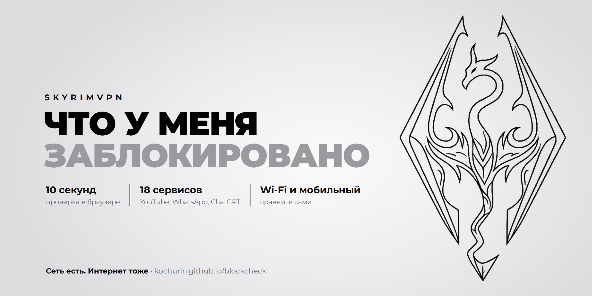

# Что у меня заблокировано

**[Открыть проверку → kochurin.github.io/blockcheck](https://kochurin.github.io/blockcheck/)**

Страница за несколько секунд показывает, какие сервисы не открываются в вашей сети: YouTube, Instagram, WhatsApp, Discord, ChatGPT, Gemini и ещё десяток. Удобно сравнить домашний Wi-Fi и мобильный интернет, а ссылкой с результатом можно поделиться

## Как это работает

- Страница пробует загрузить маленький файл (favicon) с каждого сервиса прямо из вашего браузера
- Не ответил за 8 секунд или соединение оборвалось — сервис помечается как недоступный, отвечает дольше 3 секунд — как медленный
- Российские сайты (Яндекс, ВКонтакте, Госуслуги) проверяются отдельно: если работают только они, это похоже на белые списки
- Результаты остаются у вас в браузере. Сервера нет, аналитики нет, всё в одном файле `index.html`

Перед проверкой выключите VPN, иначе откроется всё

## Ограничения

Проверка показывает, доступен ли сервис, но не скорость видео. Если YouTube отмечен как открывающийся, а ролики всё равно тормозят, проблема в замедлении видеопотока, его отсюда не видно

## Если что-то не открывается

- [Гайд: белые списки на мобильном интернете и что с ними делать](https://kochurin.github.io/whitelist-guide/)
- [Бесплатные прокси для Telegram](https://github.com/Kochurin/telegram-mtproto-proxy)
- VPN, который работает и на белых списках: [@SkyrimVPN_bot](https://t.me/SkyrimVPN_bot?start=blockcheck), первые 3 дня бесплатно · [сайт](https://skyrim.connecto.lol/?utm_source=blockcheck)

Нашли сервис, который стоит добавить, или ошибку в проверке? Откройте issue

Сеть есть. Интернет тоже
